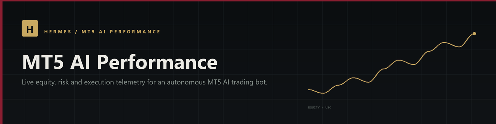
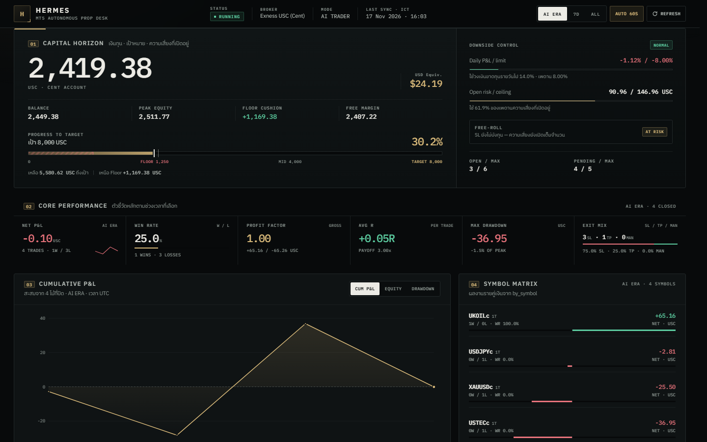

# MT5 AI Performance — HERMES Live Dashboard



**Live performance telemetry for an autonomous MT5 AI trading bot — equity, risk, positions, trades, AI lessons and decision journal in one dark dashboard.**

[](https://github.com/Plub-Supanut/mt5-ai-performance/releases/latest)
[](https://github.com/Plub-Supanut/mt5-ai-performance/actions/workflows/ci.yml)
[](https://plub-supanut.github.io/mt5-ai-performance/)
[](#how-the-data-updates)
[](LICENSE)

**Quick links:** [Live demo](https://plub-supanut.github.io/mt5-ai-performance/) · [Download v1.1.0](https://github.com/Plub-Supanut/mt5-ai-performance/releases/latest) · [Changelog](CHANGELOG.md) · [Release policy](https://github.com/Plub-Supanut/plub-standard/blob/main/GITHUB_STANDARD.md)

---

## Overview

This repository is the **public performance dashboard** for HERMES, a personal autonomous MetaTrader 5 (MT5) AI trading bot. The bot trades a single **Exness USC Cent account**; a separate private sync pipeline exports its history to `data.json`, and this repository publishes that snapshot as a single-file, dark-themed dashboard on GitHub Pages.

It answers one question at a glance: *how is the bot actually doing right now, and how much risk is on the table?* Every number on the page is computed from `data.json` in the browser — there is no backend and no build step.

**Who it is for:** anyone following the bot's live results, the operator reviewing risk and trade quality, and developers who want a transparent reference implementation of a self-hosted trading performance dashboard.

> This is a personal project, not a product. The account is small, real, and can lose money — see the [disclaimer](#attribution--disclaimer).

## Quick start

1. **Open the live dashboard:** <https://plub-supanut.github.io/mt5-ai-performance/>
2. **Or download the latest release zip** from [Releases](https://github.com/Plub-Supanut/mt5-ai-performance/releases/latest), unzip it, and serve the folder locally:
   ```bash
   python -m http.server 8080
   ```
3. Visit <http://localhost:8080> — the page loads `data.json` from the same folder and refreshes itself.

> Opening `index.html` directly as a `file://` URL will not work: browsers block the `fetch()` of `data.json`. A local static server (or GitHub Pages) is required.

## Features

- **Capital horizon** — balance, equity, peak equity and floor cushion against an `8,000 USC` target on one screen.
- **Risk guardrails** — daily P&L versus the `-8.00%` limit, open risk versus ceiling, free-roll/at-risk status, and position/pending caps.
- **Equity curve** — cumulative P&L, equity and drawdown views over the selected range (`AI ERA`, `7D`, `ALL`).
- **Core performance stats** — net P&L, win rate, profit factor, average R, max drawdown and exit mix (SL / TP / manual).
- **Live positions and pending orders** — open tickets with entry, SL/TP, floating P&L and the trade reason.
- **Closed-trade ledger** — every deal with side, volume, R multiple, outcome and exit type.
- **Symbol matrix** — per-symbol P&L, win rate and trade count so weak instruments stand out.
- **AI lessons** — the bot's own post-trade reflections, tagged and linked to positions.
- **Decision journal** — a chronological log of the bot's decisions, risk sizing and reasoning.
- **Structured AI theses** — every entry reason (positions, pending orders, closed trades, journal rows, lessons) is parsed into a labelled record: structure chips, a SL / TP / R:R fact row, semantic clause labels (alignment, setup, invalidation, target, result, why, rule) and the untouched original text under **RAW**. Each entry also exposes the same data as JSON (`data-thesis-json`) for AI agents and tooling — see [`docs/thesis-contract.md`](docs/thesis-contract.md).
- **Auto-refresh** — the dashboard re-reads `data.json` every 60 seconds and can be refreshed manually; the snapshot itself is rebuilt roughly every 15 minutes.

## Screenshots



*Live dashboard (desktop, 1440×900). Thai-language UI with English metric labels.*

## Controls & usage

| Control | What it does |
| --- | --- |
| `AI ERA` / `7D` / `ALL` | Changes the reporting window for stats and charts. |
| `CUM P&L` / `EQUITY` / `DRAWDOWN` | Switches the main chart between cumulative P&L, account equity and drawdown. |
| `AUTO 60S` | Toggles automatic re-fetch of `data.json` every 60 seconds. |
| `REFRESH` | Fetches `data.json` immediately. |
| Position / trade rows | Read-only rows showing entry, exit, SL/TP, R multiple and the bot's reason. |
| `AI Entry Thesis` / `Trap Thesis` | Expands the structured thesis: timeframe/bias chips, SL / TP / R:R, labelled clauses and **RAW** text. |
| Trade row / `รายละเอียด` | Opens the detail drawer with the entry thesis and the linked post-trade lesson. |

There are no keyboard shortcuts, no login, and no write actions — the dashboard is read-only. Every thesis and raw-text disclosure is a native `<details>` element, so it can be opened with Enter or Space and has a visible focus ring.

## Project structure

```text
mt5-ai-performance/
├─ index.html                     # single-file dashboard (HTML + CSS + JS)
├─ data.json                      # auto-generated snapshot read by the page
├─ schema.sql                     # SQLite schema for the bot's history DB
├─ assets/
│  ├─ banner.png                  # README banner
│  ├─ screenshot-dashboard.png    # live dashboard capture
│  └─ social-preview.png          # 1280×640 social preview
├─ docs/
│  ├─ thesis-contract.md           # THESIS-1: agreed thesis grammar, fields and render rules
│  ├─ thesis-prompt-addendum.md    # proposal only — not applied to the live bot prompt
│  └─ releases/                    # release notes (template + v1.0.0, v1.1.0)
├─ .github/                       # CI workflow, issue forms, PR template
├─ CHANGELOG.md
├─ LICENSE
└─ README.md
```

The thesis parser and component are ordinary functions in `index.html` (`parseThesis`, `thesisBodyHtml`, `thesisDetailsHtml`). They run in the browser on every render, use no dependencies and make no requests. The renderer implements [`docs/thesis-contract.md`](docs/thesis-contract.md) (`THESIS-1`) exactly: lossless clause segmentation, the 14-label enum, four `parse.mode` states and the rule that a null fact is simply absent. Thesis text is always escaped, never interpreted as HTML.

## How the data updates

`data.json` is generated outside this repository by the bot's private sync pipeline (MT5 history + live positions + AI journal/lessons → SQLite → JSON export) and committed by an automated job roughly every 15 minutes. The dashboard never writes to it.

- `generated_at` records when the snapshot was produced; the header shows that timestamp.
- Because the data is a periodic snapshot, open positions and floating P&L can lag live MT5 by up to one sync interval.
- The repository's CI validates the snapshot structure on every push and pull request, but it does **not** validate trading logic or guarantees about the numbers.

## Development

There is no compile step. To preview or validate locally:

```bash
# 1) Serve the static site (required for fetch of data.json)
python -m http.server 8080

# 2) Sanity-check the data snapshot
python -c "import json; d=json.load(open('data.json', encoding='utf-8')); print(sorted(d))"

# 3) Watch the latest CI run
gh run list --limit 5
```

CI (`.github/workflows/ci.yml`) runs on every push to `main` and on pull requests: it validates `data.json` keys, checks that `index.html` references `data.json`, confirms `schema.sql` is non-empty, and scans tracked files for obvious secrets.

Screenshot regeneration (headless Chrome):

```bash
chrome --headless=new --disable-gpu --hide-scrollbars --window-size=1440,900 \
  --screenshot=assets/screenshot-dashboard.png \
  https://plub-supanut.github.io/mt5-ai-performance/
```

## Release policy

This project follows the **Plub GitHub Project Standard**: SemVer (`MAJOR.MINOR.PATCH`), annotated `vX.Y.Z` tags, hand-written release notes in [`docs/releases/`](docs/releases/), a maintained [`CHANGELOG.md`](CHANGELOG.md), and a downloadable artifact attached to every GitHub Release.

- Standard: <https://github.com/Plub-Supanut/plub-standard/blob/main/GITHUB_STANDARD.md>
- Releases: <https://github.com/Plub-Supanut/mt5-ai-performance/releases>

## Attribution & disclaimer

- **Project:** built and operated by [Plub-Supanut](https://github.com/Plub-Supanut). Dashboard design and bot implementation are personal work.
- **Data source:** one personal **Exness USC (Cent)** MT5 account, exported automatically by a private sync pipeline. Numbers reflect **one personal account only** and are **auto-generated**; they are not audited, independently verified, or representative of any other account.
- **Trading engine:** HERMES, a personal autonomous MT5 AI trading bot. Trades are executed automatically, without per-trade human approval.

> **Not financial advice.** This dashboard is for personal record-keeping and education. Nothing here is investment, trading, tax, or legal advice, nor a recommendation to buy or sell any instrument. Trading leveraged FX/CFDs carries a high risk of loss; **positions can be lost and the account can lose money**. Past performance does not indicate future results. The software and data are provided **"as is"**, without warranty of any kind. You are solely responsible for any use you make of them.

No broker credentials, account numbers, server names, login details, or investor passwords are published in this repository. Please do not submit them in issues or pull requests — see [`.github/ISSUE_TEMPLATE/data_issue.yml`](.github/ISSUE_TEMPLATE/data_issue.yml).

## License

**All rights reserved.** This is a personal project: the code, dashboard design and trading data are **not** licensed for reuse, modification, or redistribution. See [LICENSE](LICENSE) for the full terms.
